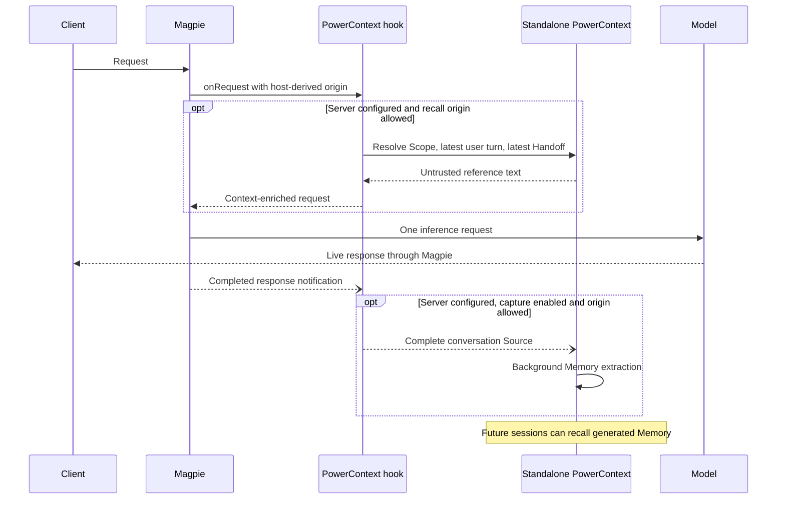

# PowerContext gateway plugin

Recall sends the latest user turn to the PowerContext Server configured explicitly
in plugin Options, even when capture is off, and adds returned Memory/Profile
context to the model request. Optional capture exports full user and assistant
turns, including client tool calls and results, to that same Server. Capture is
off by default. No configured URL means no service requests. Recall and capture
allow only host-classified local requests by default; other callers require
separate `recallRemote` and `captureRemote` opt-ins.

Requires a Magpie build supporting the proposed async gateway hooks in
[yetone/magpie#2118](https://github.com/yetone/magpie/issues/2118). This is not
compatible with stable versions that only expose synchronous middleware.

## Installation and connection

Install and operate PowerContext separately, following its
[official installation walkthrough](https://powercontext.oceanbase.io/en/docs/get-started/quickstart/).
The plugin does not install dependencies, download executables, launch a Server,
or manage its lifecycle. The current reference service is PowerContext 1.3.0.
Use the Server configuration wizard to configure storage, authentication and
background generation. Keep the Server running under your own process manager.
Follow the Server installation/configuration steps only; the separate Codex or
Claude hook setup in that walkthrough is unnecessary for gateway recall.
Create a Scope using PowerContext and configure its ID below.

This package is unpublished and the Magpie hook API is not released. With an
explicitly compatible development build, install from the local checkout:

~~~sh
magpie plugin add "/absolute/path/to/packages/powercontext"
magpie plugin options "/absolute/path/to/packages/powercontext" '{"serverUrl":"http://127.0.0.1:8000","scopeId":"YOUR_SCOPE","authorizationEnv":"POWERCONTEXT_AUTHORIZATION","gatewayTimeoutMs":5000}'
~~~

Once the hooks are released and this package is merged, it uses the repository's
normal [publishing flow](../../README.md#publishing): the shared workflow packs
it onto the `dist` branch, with a SHA-512 integrity entry, and publishes to npm
when available. Magpie's `dist` fallback (available since 0.1.1243) removes the
need to wait for a first npm publish; that version alone does not support this
package's gateway hooks. The `on-npm` check reports an unpublished package as a
notice. Keep this package out of `registry.json` until a compatible host is
released. No separate PowerContext publishing workflow is needed.

Provide POWERCONTEXT_AUTHORIZATION=Bearer <server token> in Magpie's existing
protected environment configuration. Do not put credentials in Git or client
model prompts. For remote Servers, use HTTPS. Installation and options use the
same Magpie plugin controls as other packages; installing this plugin does not
start the independent Server. Recall and opt-in capture require no client MCP
or skill.

## Behavior and options

- `serverUrl`: standalone Server base URL, **no default**. Set it explicitly
  in Options; without it,
  neither recall nor capture sends anything.
- `authorizationEnv`: bearer authorization variable (default `POWERCONTEXT_AUTHORIZATION`).
  `authorization` is also accepted in protected local plugin options.
- `scopeId`: explicit Scope. If absent, resolve an existing Magpie session or
  workspace binding. A missing binding fails open; the plugin does not create
  scopes or grant a model permission to change them.
- `recallRemote`: default **false**. Recall and sticky context replay allow only
  host-classified `local` requests. Remote, named/shared Gateway Key and missing
  or unknown origins make no service requests by default. Enable this option
  only if these callers may send their prompts to the configured Server and
  receive its Scope's Memory/Profile. It does not enable capture. Recall caches
  are isolated by origin and protocol, including when remote recall is allowed.
- `maxBytes`: recall budget, default 8000 bytes.
- `gatewayTimeoutMs`: Magpie's bounded async hook deadline, default 5000 ms.
- `capture`: enable completed-conversation capture, default **false**. Recall
  works independently. Set `"capture": true` explicitly in Options to opt in.
- `captureRemote`: default **false**. With capture enabled, only host-classified
  `local` requests are captured. Remote, named/shared Gateway Key (even on
  loopback), and missing/unknown origins are skipped. Set `"captureRemote": true`
  only if you intend to capture these other callers too and have their consent.
  This option alone does not enable capture or recall. With capture explicitly
  enabled, it may send Scope-resolution requests and conversation Sources even
  when remote recall is disabled. Forwarded/proxied requests are
  nonlocal even when Magpie trusts the proxy for authentication.
- `idleCaptureMs`: default ten minutes; range 1000–86400000 ms. A later user
  turn confirming a retained answer can trigger capture earlier.
- `allowInsecureHttp`: explicit opt-in for non-loopback HTTP; prefer HTTPS.

`POWERCONTEXT_SERVER_URL` and `POWERCONTEXT_SCOPE_ID` are not read; stale
settings from another integration cannot enable this plugin or override its
Scope. The authorization environment variable remains supported for credentials.
Scope resolution sends the session ID as a binding key and a SHA-256 digest of
the normalized workspace path. Source metadata uses SHA-256 digests for both
session ID and workspace path; it does not contain their raw values. Conversation
content is otherwise complete and can itself contain paths or identifiers.

Chat Completions, Responses, Anthropic Messages and Gemini requests retain their
protocol. Context is escaped and enclosed as untrusted reference text in the
latest user message, preserving prior context blocks for prompt caching. Latest
committed Handoff hints accompany recall when available. Credentials are not
included in model input. Timeout, invalid context, unauthorized access and a
service outage keep inference available.

Capture stores the complete conversation available to the request: user and
assistant messages, plus client-owned tool calls and results when supplied by
the client. It excludes injected reference blocks and private authorization.
Responses `previous_response_id` history is recovered only for capture when
observed by this host; missing history does not modify model input or pretend to
be a complete transcript. Failed, truncated and incomplete replies are skipped.

The gateway completion notification and plugin's idle capture timer are
best-effort. Process shutdown can lose pending capture; this is not durable or
exactly-once delivery. Source identifiers/digests provide stable content
identity, but do not establish an exactly-once guarantee. Each Source fragment
is attempted once. An uncertain or failed write is not automatically retried;
remaining fragments stop after a failure, and delivery may be lost or partial.

PowerContext's configured background inference turns Sources into Memory. It
needs its own generation model and credentials; the plugin does not reuse the
client's model authorization. Configure generation through the independent
Server's documented setup.

## Memory tools

This plugin neither declares nor executes memory tools. If an Agent needs
explicit search or remember tools, configure PowerContext's existing MCP server
through the client's Library MCP integration. The client owns tool execution and
subsequent model calls. Automatic recall/capture requires no MCP or skill.

## Validation

Run `bun test packages/powercontext` from the repository root. Tests use fake
HTTP responses and do not install or start PowerContext. Independent real-service
acceptance is maintained outside this repository, with results posted in the PR.
Passing those checks against a development Magpie build does not establish
compatibility with a released host; adoption must wait for #2118 and a compatible
Magpie version.
